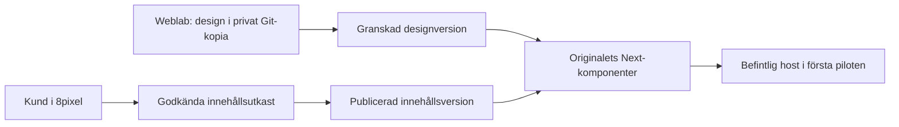

# Vanlig kundredigering och Weblab + 8pixel

Datum: 2026-10-15. Status: lokala kodrättningar, granskade och fokuserat kontrollerade. Magmas privata kopia har körts och förberedda vyer är browserkontrollerade. Riktig source-engine/native-skrivning/historik och render efter explicit reload är accepterade i ett avgränsat prov. Autentiserad native Apply/Undo/Redo, editorreload och faktisk desktop-återöppning är nu verifierade för ingressens marginal i tre storlekar. Omedelbar CMS-publiceringsrefresh, paketerad release, bred kundacceptans och 8pixel-integrationen återstår. Ingen push, deploy, originaländring, kund-/produktions-CMS-skrivning eller kundinbjudan.

## Beslut och mål

Arbeta mot en liten sammanhängande produkt: öppna en verklig kundkopia, välj rätt element, ändra stödd text/design, spara, ladda om, ångra/gör om och öppna igen. AI-genererad sajtoutput ligger utanför denna uppgift.

För kombinationen med 8pixel rekommenderas **en kodkälla och en innehållskälla**. Weblab redigerar originalkomponenternas design i en privat Git-kopia. Kunden redigerar godkända innehållsfält i 8pixel. Sajten läser dessa fält när den renderar. Designerändringar får aldrig återställa kundens copy till gamla startvärden.

Det följer 8pixels redan dokumenterade originalkodsbeslut, [import modes](</Users/ludvighedin/Programming/8pixel/8pixel-builder/docs/architecture/site-import-modes.md:3>). Det är ännu inte en accepterad koppling för Magma eller Endra.

## Uppföljning 2026-10-16

Ägarbeslut: **behåll Sanity som innehållskälla för Magma först; bygg 8pixel-kopplingen separat**. Inga publicerade dokument eller original ändras. Första användbara vägen återanvänder Magmas befintliga Sanity Studio för copy och Weblab för design. Ingen ny native-innehållspanel behövs. Generisk canvastext får inte ersätta CMS-uttryck. En separat femfältsadapter undersöktes men förblev oanvänd forskning och flyttades ur appkoden till bevismappen, efter granskning.

Stylesheet-upptäckten är rättad och oberoende granskad i lokal källa. Den följer verkliga relativa CSS-importer från samtliga dokumentrötter och vägrar tvetydiga eller ofullständiga routeträd, dynamisk CSS och importerade tokenkällor utan säker ägare. Anropen kräver nu en komplett filinventering; läsfel i en underkatalog stoppar kapabiliteten i stället för att döljas. Befintlig vanlig filbläddring behåller sitt tidigare best-effort-beteende.

48 fokuserade fall passerar, inklusive ett reproducerat inventeringsfel som först misslyckades före rättningen. File-system och webbklientens typer passerar; riktad lint har0 fel och369 varningar. Bevis: `../weblab-customer-acceptance-20261016-GUUDLV/{stylesheet-check,discovery-fs-types,discovery-client-types,discovery-lint}.log`.

Hela Magma vägras fortfarande korrekt av den gemensamma Tailwindflaggan, eftersom Studio har en separat dokumentrot utan samma globala CSS. Detta ska inte lösas genom att slå på osäkra kontroller. En separat, snäv CSS Modules-skrivare finns nu i lokal appkälla som Component class · All sizes. Den stöder exakt direkt klassbindning och befintliga margin-top/max-width/color/font-weight-värden, med kontroller av JSX-ägare, CSS-överlapp, källkonflikter och markerad historik.69 fokuserade fall och webbklienttyper passerar, riktad lint0 fel, oberoende granskning klar. En riktig CodeFS-indexväg med inledande slash upptäcktes under harnessbygget och är rättad/testad. Faktisk native/disk/renderacceptans körs separat; detta är inget fullständigt CSS-system eller kundgodkännande. Separat JSX-läsning och CSS-skrivning är inte atomiska över externa processer; observerade källrevisioner kontrolleras före skrivningen.

Riktig desktopkälla0.2.6 körs mot isolerad nativeprofil och test-Clerk. Browser/OS-leveransen för native-inloggning injiceras i testet, medan verkliga nonce-/ticketgränser behålls. Det tidiga signup-provet stannade vid en synlig mänsklig CAPTCHA. Det senare ägargodkända DEV-kontots riktiga OTP/native-inloggning och avgränsade editorprov passerar enligt fortsättningen nedan; signup/CAPTCHA är inte accepterade. Inga kundarbetsytor eller CMS-skrivningar har öppnats av detta prov. Den installerade0.2.0 räknas fortfarande separat.

Inloggningsuppföljning: ägaren bad agenten hantera CAPTCHA-klicket. Det gamla Chrome-fönstret hade stängts; read-only anslutning till befintlig Dia-session gav timeout utan att läsa eller ändra flikar. Clerk har ett officiellt, kortlivat och instansbundet [Testing Token-läge](https://clerk.com/docs/guides/development/testing/overview). Lokal testkonfiguration och Backend API-domän är verifierade mot exakt `full-redbird-32.clerk.accounts.dev` och DEV Convex. Ett isolerat v7-prov är förberett och syntaxkontrollerat, men inte kört. Registreringssidan säger att registrering godkänner Weblabs villkor. Vid den kontrollpunkten inväntades uttryckligt ägarbeslut innan registrering; inget konto/token hade skapats. Fortsättningen efter ägarens ja dokumenteras nedan. Inga säkerhetsinställningar ändrades. Detta är en testmiljöspärr, inget bevis på en produktbugg. Provet ska redovisa Testing Token som testsubstrat och får inte räknas som test av mänsklig CAPTCHA eller produktionsskydd.

### Inloggat desktopprov, fortsatt 2026-10-16

Ägaren godkände uttryckligen ett separat utvecklingstestkonto och villkoren. Rätt Clerk-utvecklingsinstans verifierades genom både publika nyckeln och Backend API-domänen; Convex är fortsatt DEV. Ett exakt QA-konto skapades via Clerk Backend API, med nödvändigt unikt användarnamn och utan lösenord/extra behörigheter. Backend API verifierar mejladressen som standard. Riktig UI-inloggning med testmejlkod och native nonce/ticket-inlösen passerade och öppnade kontots nya personliga arbetsyta. Inloggningen överlevde faktisk stängning/återöppning av isolerad Electron-profil. Browser/OS-leverans är fortfarande uttryckliga transportfixturer. Detta accepterar inte signup, mänsklig CAPTCHA, mejlleverans eller produktionsskydd.

Clerks officiella testtoken gav inte en fungerande nyregistrering i vår SDK-kombination: `sign_ins` gav identifier-not-found och klienten återgick till CAPTCHA innan `sign_ups` skickades. Token och svarens bypassfält provades enbart i isolerade testharnessar. Det räknas som testbegränsning, ingen godkänd registreringsresa. Inga produktions-/säkerhetsinställningar ändrades. Se `clerk-qa-fixture.json`, `native-auth-proof-v10.json`, de bevarade misslyckade v7–v9-kvittona och officiell hjälparkälla med hash i bevismappen.

Det riktiga dashboardprovet hittade ett onödigt anrop till en saknad experimentell molnfunktion i desktop. Lokal källrättning väntar tills browser/desktop är känt och monterar inte molnpiloten i desktop, enligt den lokala releaseprofilen. Browserbeteendet behålls. Webbklienttyper passerar; riktad lint hade0 fel och två formatvarningar före importordningsstädning. Före/efter-bilder finns i `desktop-dashboard-{before,after}-guard.*`.

Verklig Open folder skapade en ny separat native-kopia och ett nytt DEV-projekt. Backend-bootstrap bekräftar local-runtime, rätt privata rot och tre localhost31847-ramar. Editorn fastnade ändå före varje installationsförsök. Faktiskt fel är `The branches are already closing` från init/clear under StrictMode, och cleanup kan senare stänga den monterade editorn. Rättningen är nu oberoende granskad och10 verkliga React/StrictMode-livstidsfall samt riktig Retry-dokumentladdning passerar i T3-preview, med kontrollerad engine/servicegräns. Riktad lint har0 fel/67 varningar. Native återöppning kommer förbi detta fel och visar editorn. Det senare avgränsade native UI-provet passerar enligt nedan; ingen bred kundacceptans följer av detta. Se `qa-project-bootstrap-read.json` och `magma-startup-before-lifecycle-fix.*`.

Den nya kopian är `native-user-data/weblab-private-working-copies/5da47749-bd28-44d9-9ce6-21ebcf944a5d/project` i bevismappen. Rå automatisk installation är pausad av testtransporten så inget tungt arbete undgår datorns skydd. Samma riktiga native-installer körs separat via en tillfällig exakt hash-/rot-/copy-ID-bunden registrering med oförändrad admission/1536MB-gräns. Installationen lyckades och registreringen är återställd med exakt byte-/mode-kontroll; ingen generell tillåtelselista eller RAM-gräns breddas.

Nästa verkliga UI-stopp är bekräftat: routerdetektorn kräver direkt `src/app/layout.*`, medan Magma har giltiga separata dokumentlayouter under `[locale]` och ruttgrupper. Felaktigt unsupported-fel uppstår före förberedelse. Detektorn hittar nu befintliga nästlade layouter med begränsad katalogläsning.14 riktade fall passerar och oberoende granskning är klar. AST-granskningen av dokumentlayouter försvagas inte. Senare faktisk native återstart når preview och passerar UI-provet nedan. Se `magma-nested-layout-startup-blocker.*`.

### Riktiga reglage och historik, fortsatt 2026-10-16

Den autentiserade desktopeditorn har nu faktiskt öppnat Magma vid375/768/1440. Genom canvas-klick och Component class-reglaget ändrades ingressens margin-top40.2→48px med riktig Apply. Native disk och alla tre levande iframes visar48px efter faktisk FrameManager-refresh. De synliga Undo/Redo-knapparna återger40.2 respektive48px i alla tre vyer. Ingen engine-/selection-/storage-injektion används här. Auth/OS-dialog och registrerad native dev-spawn är fortsatt uttryckliga testtransporter. Denna nya körning använder sajtens fallback, inte publicerad Sanity-copy. Bevis: `magma-ui-{baseline,apply48,undo,redo}.json`.

Första uppstarten tog runt3min. En faktisk2s CPU-profil visar UI:ns rekursiva filläsning som het väg. Koden startade obegränsat många omläsningar per filhändelse under snapshot-uppdateringen. Hookens omläsningar samlas nu och körs en i taget per aktiv prenumeration.8 riktade React-fall passerar via T3-preview, inklusive300 samtidiga events och sena svar efter byte/unmount. Fysisk watcher-cleanup vid async katalogsetup är också rättad och granskad;8 riktade faktiska ZenFS-fall passerar. Senare native återöppning och editorreload passerar, men ingen jämförbar uppstartsmätning efter samtliga rättningar är gjord.

Faktisk editorreload återläser Undo-historiken men preview stoppas: redan förberedd no-op-plan kräver felaktigt tom historik. Detta var ett kundstopp. Rättningen är granskad och28 riktade förberedelsefall passerar. No-op-plan verifierar samma mirror, källversion och disk utan historik-/actionlease eller skrivning. Ändringar behåller kravet på tom historik. Senare faktisk editorreload och desktop-återöppning behåller48px och fungerande Undo/Redo. Det tidigare felet finns kvar som `magma-ui-reload-history-blocker.*`.

### Autentiserad native återöppning och reload

Samma isolerade source-Electron0.2.6 och QA-konto passerar nu faktisk stängning/återöppning av desktopappen samt `page.reload`. Ingressens48px och Undo-historiken finns kvar. Synliga Undo/Redo efter båda återöppningsvägarna ger40.2/48px i375/768/1440. Detta använder riktiga reglage, sparad browserhistorik, native källskrivning och faktisk FrameManager-refresh. Inga engine-/selection-/storage-fixturer används i detta UI-prov. Auth/OS-transport och registrerad native dev-spawn är fortfarande redovisade testtransporter; den installerade0.2.0 är en annan produktväg.

Ogiltigt `#gggggg` visar synligt fel, behåller utkastet och ändrar inte källan. Bevis: `magma-ui-{apply48,undo,redo,desktop-reopen,reopen-undo,reopen-redo,invalid-input,reload-success,reload-undo,reload-redo}.json` samt `native-ui-final-source-pins.json`. `magma-original-after-native-ui-edits.json` verifierar samtliga334 originalhashar, HEAD och status oförändrade. No-op-förberedelse28, providerlivstid10, kataloghook8, router14 och fysisk watcher8 fokuserade fall passerar. Detta accepterar den snäva design-/historikresan på fallback-copy, inte CMS-copy, export/publicering, Endra-runtime eller kundredo produkt.

### Verklig Magma-acceptans 2026-10-16

- Riktig CodeManager, CodeFS/index, LocalMirror, NodeFsProvider, ActionManager Undo/Redo och HistoryManager spara/ladda kördes mot exakt den bevarade privata Magma-kopian. Native lease/journal/intent/CAS/reconcile användes för källskrivningar.
- Åtta synkroniserade faser kontrollerades med verklig Chrome på `/se` efter explicit reload i1440/375: baseline24px, save40px, undo24px, redo40px, reload40px, ny engine/käll-/historikåterläsning40px, återläst undo24px och redo40px.
- En injicerad exakt JSX-klassändring med fördröjd watcherleverans vägrade nästa CSS-sparande. Endast provets exakta bytes återställdes via CAS. Ren native handoff innehåller enbart den avsedda CSS-filen; samtliga334 originalhashar/HEAD/status är lika före och efter.
- Testsubstrat: riktig ZenFS InMemory i stället för browser IndexedDB, filbaserad localforage-driver, IPC-transportshim över riktiga nativefunktioner, injicerade auth/selection/branch-stores samt telemetri för frame-reload. Browsern utförde verklig explicit reload. Detta är inte full autentiserad UI, faktisk FrameManager-refresh, IndexedDB-kraschåterhämtning eller återöppning av desktopappen.
- Bevis: [engine/native](</Users/ludvighedin/Programming/personal/AB/coder-new/weblab-customer-acceptance-20261016-GUUDLV/magma-css-engine-acceptance.json>), [browser](</Users/ludvighedin/Programming/personal/AB/coder-new/weblab-customer-acceptance-20261016-GUUDLV/magma-css-browser-proof.json>). Första försöket misslyckades före fixturstart på testets Node-importresolver. Exakt fel/bytes finns kvar i `magma-engine-attempt1-interop`; inga appfiler rättades för det harnessfelet.

Efteråt kördes samma privata sajt med uttryckliga **publika Sanity-koordinater**, inga tokens och endast publicerade läsningar. Både US och SE gav200; verklig hero-intro matchar direkt Sanity-snapshot och den sparade40px-klassen finns kvar vid1440/375, utan fallbackvarningar/pageerrors. Studio/draft mode öppnades inte och inga providerwrites gjordes. Browsern blockerade externa anrop; extern media/helhetsutseende är inte accepterade genom detta prov. [Publicerat läsprov](</Users/ludvighedin/Programming/personal/AB/coder-new/weblab-customer-acceptance-20261016-GUUDLV/magma-published-read-browser-proof.json>).

### Ingressens tre designfält, uppföljning

Den exakta lokala `delay(ms)`-funktionen är nu källbevisad som enbart `--delay`; den bevaras oförändrad. Okända hjälpare fortsätter vägras. Modern numerisk RGB med valfri alpha stöds med snäva gränser och exakt strängbevarande för Undo.

69 fokuserade fall och webbklienttyper passerar, oberoende granskning klar, riktad lint0 fel/167 varningar. Ett separat riktigt introprov passerar14 faser i båda375/1440: marginal40.2↔48px med historik-/källåterläsning, färgRGBA↔hex och maxbredd431↔320px. Varje DOM-kontroll verifierar hela stilvektorn, exakt publicerad Sanity-intro och tidigare sparad knappmarginal40px. Native handoff innehåller bara avsedd CSS; JSX och alla334 originalhashar/HEAD/status är oförändrade. Inga providerwrites. Samma uttryckliga testsubstrat/UI-gränser som ovan gäller. [Intro engine/native](</Users/ludvighedin/Programming/personal/AB/coder-new/weblab-customer-acceptance-20261016-GUUDLV/magma-intro-engine-acceptance.json>), [28 browser-vyer](</Users/ludvighedin/Programming/personal/AB/coder-new/weblab-customer-acceptance-20261016-GUUDLV/magma-intro-browser-proof.json>).

### Sanity för Magma först

Privatkopians befintliga `/studio` har Markets → Sweden/United States → Pages → Home. Studio äger innehållet och sparar utkast via redaktörens Sanity-inloggning. Weblab äger designkoden. Studio förhandsvisar sin egen browser-origin, `/se` för Sverige och `/us` som sätter US-marknaden före `/`. Draft-preview går via befintlig `/api/draft-mode/enable` och serverns lästoken. En runtime-skrivtoken behövs inte.

För ett säkert verkligt prov krävs uttryckliga koordinater till ett disponibelt Sanity-projekt/dataset, redaktörsinloggning, Viewer-lästoken och verifierad credentialed CORS för exakt privat preview-origin. Ett separat personligt Sanity QA-projekt `rixa07uh` med dataset `weblab-qa` är skapat, med dataset/CORS och nollprissatt Growth-trial. Fyra bilder och två hero-sidor är seedade; två robotidentiteter har24 timmars giltighet. Riktiga Studio-proven nedan har passerat. Kundens befintliga projekt/dataset har inte ändrats. Utan public koordinater visar webbplatsen lokal fallback, men **Studio faller ändå tillbaka till kundens förvalda production-dataset**. Öppna därför inte Studio för skrivprov innan testkoordinater verifierats. En renderad fallback bevisar ingen CMS-anslutning. Publicering till kundens production ligger utanför detta prov.

### Riktig Sanity Studio och ny native-spärr

I QA-Studio blockerar tom ingress och221 tecken Publish. Ett giltigt utkast med accent och radbrytning överlever Studio-återöppning. QA:s publicerade ingress ändras först efter faktisk Publish. Riktig Presentation visar text som bara finns i utkastet. Sweden-provet finns i slutkvittot. Normal dev-render visade först cachelagrad gammal copy; en no-cache GET följd av render visade aktuell copy. Detta är ingen accepterad automatisk native-refresh. Båda ursprungliga production-Home-dokumentens `_rev` är oförändrade.

Bevis: `sanity-qa-studio-ui-{proof,final-proof}.json`, `sanity-qa-valid-draft-api.json`, `sanity-qa-published-api.json` och `sanity-original-home-after-qa-studio.json` i bevismappen. QA:s `.env` har flyttats säkert utanför projektet före nästa nativeprov; inga credentialbytes ska exporteras. Filnamnsskyddet som vägrar `.env` i projektet behålls.

F-850/T-894 är nu verifierad i riktig native UI: kugghjulets publika Sanity projekt-ID/dataset sparas via NodeFsProvider i privat metadata utanför projektet. Giltig Save startar om preview och visar riktig QA-ingress med48px i375/768/1440. Modalens återöppning och faktisk stängning/återöppning av desktop behåller inställningarna och copyn. Ogiltig URL ger synligt fel och samma preview-PID, utan stopp. Ingen `.env`, token eller inställningsfil läggs i källträdet. Native cache9 tester/68 assertions, provider21 tester/45 assertions, klient-/providertyper och riktad lint0 fel passerar; varningar finns kvar. Oberoende källgranskning är klar.

Riktig GUI Upload-granskning/export från den aktuella kopian passerar. Patchen är537 byte och ändrar bara CSS-deklarationen2.5125rem→48px. Inga miljö-/inställningsfiler, bryggor eller QA-robotar följer med. Inga originalfiler har patchats och ingen push har gjorts. Bevis: `magma-native-handoff-{review,exported,clean-proof}.json`.

Omedelbar copy efter Sanity Publish är fortfarande **inte accepterad**. Native `onSendHeaders` och nya frame timeOrigins visar no-cache på samtliga tre dokument, men copyn var ändå gammal/blandad direkt efter publicering. Efter runt2min gav en CmdR ny copy i alla tre, med48px kvar. Bevis: `sanity-native-refresh-after-cache-window-passed.json`. Direkt CDN-läsning gav först gammal och sedan färsk copy, vilket bekräftar att en upstreamfördröjning finns. Den exakta attributionen för de ursprungliga blandade frame-anropen är ännu inte klar. Magmas riktiga next-sanity-klient med låst publik QA-konfiguration och hela samma GROQ-fråga ger nu återställd baseline via både API och CDN. Ett intilliggande direkt Next-dokument och därefter alla native-ramar är färska. Detta bevisar fortfarande inte omedelbar Publish-refresh. UI:ns nya cachefördröjningshjälp finns på EN/SV och har setts i riktig native UI. Ingen kundredo-status följer av detta.

Det anslutna nativeprovet passerar också synliga Undo40.2/Redo48 vid375/768/1440 utan copyändring. Full editorreload visar återställd QA-baselinecopy och48px i alla tre, utan fel. Bevis: `sanity-native-connected-{undo,redo,page-reload}.json`. Endast en äldre säkerhetstestfixtur korrigerades i sista uppföljningen, oberoende granskning klar; fokuserad omkörning23 tester/177 assertions passerar. Tidigare klient-/provider-typer och lintresultat gäller sina kvitton. Slutlig klienttypkontroll passerar exit0 (`local-preview-final-client-types.log`). Slutlig riktad lint för de två senaste filerna passerar exit0 med0 fel/319 varningar (`local-preview-final-lint.log`). Slutlig read-only kontroll bekräftar båda production-Home-revisionerna oförändrade samt ren original-Magma Git/HEAD (`sanity-original-home-final-readonly.json`). Alla egna previewservrar är stoppade och browserleasen är släppt. Ingen push/deploy.

### Återstående paketerad release

Källprovet gäller0.2.6, inte installerade0.2.0. Den tillåtna isolerade unsigned Mac-directory-lanen är blockerad av gammalt packaging-guard-kontrakt: dess allowlist/hash saknar nuvarande `quit-coordinator.js`. Det befintliga beta-outputet/kvittot får heller inte skrivas över. Ingen wrapper ändrades och inget bygge kördes i den här bedömningen. Electron-paketet innehåller native wrapper, inte aktuell Next.js-editor. Beta kräver separat godkänd HTTPS-frontend; lokal QA-localhost kan inte pinnas och ingen sådan frontend är nu godkänd. Paketerad demo-/auth-/distributionsacceptans återstår, utan signing/notarization, installation över ägarens app eller provider/deploy-åtgärd i detta prov.

### Textskydd 2026-10-16

Bekräftade fel är rättade lokalt: radbrytningar med kundägd styling/props får inte förbrukas och byggas om som nakna BR-taggar. Text vars innehåll ägs av `children`, spreadprops eller `dangerouslySetInnerHTML` erbjuds inte som vanlig text, och källskrivaren vägrar före mutation. Bare BR och förberedda BR med literal `data-oid` stöds fortfarande. Rich-text kontrollerar även nästlade textnoder; generiska parserns tidigare bevarande av blandad markup och dynamiska barn är oförändrat.

16 nya assertions/testfall misslyckades före rättningen. Efteråt passerar59 fall över text/text-slots/editable. Parsertyper passerar; riktad lint0 fel/39 formateringsvarningar. Oberoende granskning utan anmärkning. Slutlig webbklienttypkontroll passerade efter CSS-integrationen. Faktisk full editorresa återstår.

## Faktiskt underlag

| Underlag | Revision och status | Vad det bevisar |
| --- | --- | --- |
| Magma | `add0496bd645ce565f696b815f2795a2961f2b69` | Komplett läskopia + riktig privat native-kopia, fallback körd |
| Endra | `24f3f1a92f952cc6f4bd1c9ef111608d0b5e57b8` | Aktuell läst Git-källa, inte körd sajt |
| Weblab i denna checkout | Desktopmanifest0.2.6, omfattande befintligt lokalt arbete | Källa, inte installerad eller driftsatt funktion |
| Installerad Weblab | Tidigare observerad paketversion0.2.0 | Separat produktväg; editorns bytes/funktioner inte likställda med nyare källa |
| Fristående Weblab-källa | `../weblab-html-dropdown/apps/desktop-local`, manifest0.2.1 | Ännu en separat källrevision, inte bytebevis för installerade0.2.0 |
| 8pixel | Lokal main med omfattande befintligt arbete | Källanalys, inte färsk produktionsacceptans |

Aktuella hållbara bevis: [Magma-källa före provet](</Users/ludvighedin/Programming/personal/AB/coder-new/weblab-customer-readiness-20261015-H1oiRl/magma-source-before.json>), [efter provet](</Users/ludvighedin/Programming/personal/AB/coder-new/weblab-customer-readiness-20261015-H1oiRl/magma-source-after.json>) och [native förberedelseskrivningar](</Users/ludvighedin/Programming/personal/AB/coder-new/weblab-customer-readiness-20261015-H1oiRl/magma-preparation-native-apply.json>). Samtliga334 spårade källfiler, HEAD och status är oförändrade. Native skapade en oberoende privat kopia med333 filer, utan `.env.example`, och installerade frysta beroenden utan lifecycle-script. Därefter skrevs två bryggfiler och71 granskade källfiler med verkliga hashvillkor och journalföring. En separat granskad enfilersuppföljning utökade proxyns exakta undantag till interaktions-JSON/CSS, med samma native skrivskydd och journal.

Tidigare sparsamma inspektionskopior under `/tmp/weblab-customer-basics-20261015-OezHH8` finns inte längre. De räknas inte som aktuella körbara importer. Endra har en ny filtrerad läsklon och bevarad original-layout med revisions-/hashkvitto, utan checkout eller runtime.

I det tidiga import-/runtimeprovet öppnades eller skrevs ingen befintlig lokal kundmapp. Inga kundhemligheter kopierades, formulär skickades eller CMS-skrivningar gjordes i det provet. Senare Studio-skrivningar sker endast i separat QA enligt ovan. Magmas granskade dev-script kördes enbart i den nya privata kopian med rensad miljö. Browserproven blockerade externa anrop.

## Vad som stoppar Magma och Endra

### Magma

- Next16.3.1/React19/Tailwind4, men faktisk design använder mycket CSS Modules och dataobjekt.
- Rättat i lokal källa: publik root layout ligger under `src/app/[locale]/layout.tsx`; en vanlig root `src/app/layout.tsx` saknas. Förberedelsen hittar nu samtliga faktiska dokumentrötter, inklusive denna. Tailwinddetektorn söker bara root eller `(site)` och `./globals.css`, medan Magma importerar `../globals.css` från localegrenen.
- Den verkliga Tailwinddetektorn kördes mot klonens filer: **false**. Detta är ett kapabilitetsresultat, inte ett misslyckat browsertest.
- Normal hero-copy kommer via props/fixtures/Sanity och textkomponenter. Generisk dubbelklicksredigering får inte platta ut `{intro}` till en hårdkodad sträng.
- Magma har lokalt innehåll som fallback utan Sanityanslutning. Därför är det den enklaste första runtimekandidaten när en komplett privat kopia kan köras.

### Endra

- Next16.3.8/React19/Tailwind4 med separat Studio-workspace och mycket CSS Modules.
- Rättat i lokal källa: rootlayoutens tre alternativa `html/body`-returer motsvarar olika ingångar. Den första är inloggning, den vanliga sajten kommer senare. Injektorn förbereder nu varje body och kontrollerar bindningar/konflikter före ändring. Ingen ansluten Endra-session är körd.
- Den separata rena förberedaren vägrar flera bodyrötter helt. Desktop använder inte den förberedaren, så de två beteendena ska inte blandas ihop.
- Den verkliga Tailwinddetektorn kördes mot klonens filer: **true**. Det bevisar inte att `cn('type-display', styles.title)` eller `styles[layout]` kan skrivas säkert; elementens dynamiska klasser vägras fortfarande.
- Sanity kräver privat läsåtkomst och har ingen normal lokal sidfallback. Runtimeprovet behöver en uttryckligen läsande anslutning eller ett godkänt lokalt innehållssnapshot. Testa inga lead/webhook-formulär.

### Gemensamt

Rätt stil kan visas samtidigt som direktredigeringen saknar en säker källa att skriva tillbaka till. Det gäller både data/CMS-text och CSS Modules. Att ta bort spärrarna löser inte det.

Den fristående editorn kan lägga inline-stilar som förhandsvisning, men vanliga Apply/Save skickar dem till en kodagent för beständig källändring. CSS-variabler har en separat direkt skrivare. Den vägen ska därför inte räknas som en generell deterministisk CSS Modules-skrivare. Befintlig kodagent som sparmekanism kan provas separat, utan att utvärdera genererad design, när körmiljö och användning är avgränsade.

## Snabba rättningar: arbetsordning och färdigkrav

### Q1. Ärliga tester och skydd mot att lämna osparad lokal text

Filer: `scripts/qa/desktop-local-flow.mjs`, `src/components/store/editor/code/{before-unload.ts,before-unload.test.ts,index.ts}`, `text/{index.ts,session.test.ts}` under webbklienten.

- [x] Rätta teststeget `edit`: det tidigare steget väntade bara på `h1` och kunde ge OK utan redigering. Det vägrar nu uttryckligen tills riktiga redigeringsassertioner finns. Detta är ett rättat testbevis, inte en ny fungerande editresa.
- [x] Lägg till lokal text och öppna lokala historiktransaktioner i unloadvarningen. Behåll den redan fångade textägarens branch genom väntande start och misslyckad finalisering. Använd aldrig den för tillfället aktiva branchen som gissning.
- [x] Bevara molnets explicita återladdning av redan avvisad text. Ett annat lokalt utkast ska fortfarande hindra den återladdningen.
- [x] Elva fokuserade lyssnar-/statefall passerade. De bevisar varningslogiken, inte Electron-dialog eller automatisk sparning.
- [x] Riktiga TextEditingManager-fixturer:25 fall passerar. Webbklientens och parserns typkontroller passerar. Riktad lint har0 fel men kvarvarande varningar, så detta är inget löfte om varningsfri kod.
- [x] Verkliga close-/beforeunload-event i Electron42.2 med den riktiga unloadfunktionen: avbruten Quit behåller fönster och exakt osparad text, utan disposal. Efter avslutad edit stängs fönstret före CLI/preview-disposal. Native disposers är injicerade räknare i detta prov.
- [ ] Full editor i exakt leveranspaket: synlig dialog, fortsatt redigering, verklig save, reload och återöppning.

### Q2. Sluta stoppa förhandsvisningen före en bekräftad avslutning

Filer: `apps/desktop/{main.js,quit-coordinator.js,quit-coordinator.test.js,package.json}` och `cli/{main-bridge.js,main-bridge.test.js}`.

- [x] Mindre granskad rättning: anropa verklig `BrowserWindow.close()` innan några tjänster stoppas. Endast `closed` räknas som accepterad stängning. Befintlig renderer-veto behålls.
- [x] Veto, close-fel, timeout eller nytt fönster avbryter försöket före disposal. Ett enda OK-meddelande förklarar stoppet. Ny Quit kan provas direkt.
- [x] Deduplicera samtidiga Quit. Blockera nya fönster under avslutning och sena CLI-starter efter stream-disposal. Väntande folderleverans kontrollerar fönstrets identitet igen.
- [x]19 fokuserade native/CLI-fall och riktigt Electron-close-prov passerar. Två oberoende granskningar accepterade ändringen.

Detta är **stängningsskydd, inte autosave**. Huvudfönstret kan redan vara stängt när en senare popup vägrar. Fel under irreversibel cleanup håller återöppning blockerad och erbjuder ny Quit. En full sessionsbunden save/close-handshake, automatisk sparning och skydd mot force-kill/power-loss är separata senare krav. Prov av hela leveranspaketet återstår.

### Q3. Förbered rätt kundrutter utan att ändra originalet

Filer: `packages/parser/src/{project-preparation.ts,code-edit/layout.ts}`, `src/components/store/editor/sandbox/{preload-script.ts,preload-script.test.ts}`, `style/{local-style-writer.ts,local-style-writer.test.ts}`.

- [x] Upptäck verkliga App Router-rootlayouter via `html/body` och routeträd. Stöd `[locale]` och tillåt separata rootgrupper utan att skapa en ny rootlayout eller ändra kundens routning.
- [x] Förbered varje dokumentgren, inte bara första body. Blandade/okända skriptbindningar vägras före skrivning. Policyn är uttryckligen alla granskade dokumentrötter i den privata kopian, även login/Studio. Detta ger ingen åtkomst och ändrar inte deras guards.
- [x] Lös stilmallens faktiska relativa importväg och kontrollera komplett routeträd och Tailwindbyggkedja.48 fokuserade fall samt typer passerar. Hela Magma förblir korrekt spärrad eftersom Studio saknar samma import. En global kapabilitetsflagga gör inte CSS Modules-element skrivbara.
- [x] Visa exakt diff. Kör förberedelsen två gånger utan extra script/ID-churn. Simulera extern ändring och fel i en senare fil; inga andras bytes får rullas tillbaka.

- [x] Rätta faktiskt Magma-fel där `src/proxy.ts` språkstyrde bryggans JS till404. Förberedelsen undantar bara fyra exakta sökvägar: de två JS-bryggorna och deras interaktions-JSON/CSS i en snävt stödd statisk matcher. Övrig routing och authfunktion lämnas intakta. Okända/dynamiska konfigurationer vägras före skrivning. Alla matcherregler valideras före ändring. Den äldre tvåfilersförberedelsen kan uppgraderas utan churn och kundägda undantag bevaras vid handoff.
- [x] Rätta handoff som kunde visa massor av förberedelsebrus eller tappa verkliga ändringar utanför JSX. Helkälljämförelse bevarar kod, kommentarer, uttryck och betydelsefulla textmellanslag. Osäker kirurgisk återspelning ger granskad, omformaterad källa. Förberedelse utan designändring ger0 handofffiler på verklig Magma-källa. Matcherundantag tas bort mot originalets exakta regel.

Endras verkliga layout klarar också3 dokumentreturer, idempotens och ren handoff utan källändring, [kvitto](</Users/ludvighedin/Programming/personal/AB/coder-new/weblab-customer-readiness-20261015-H1oiRl/endra-layout-branch-proof.json>). Magmas fyra dokumentrötter är källkontrollerade. Publik fallback är körd; login/Studio öppnades inte. Endra behöver fortfarande ett anslutet läsande runtimeprov. Tailwind-/CSS Modules-stöd har inte breddats genom dessa rättningar.

### Q4. Bevisa minsta riktiga redigeringsresa på Magma

Utgå från en ny komplett privat kopia, med Git-originalets HEAD/status/innehållskvitton före och efter. Ingen push-url eller produktionsnyckel behövs för detta steg.

- [x] Starta Magma med dess lokala fallback, med externa skrivningar/formulär ur testresan. `/` och `/se` ger200. Båda bryggfiler ger200 med exakt aktuellt bundlehash. Smal375 och bred1440 vy laddar utan pageerrors och med en brygguppsättning per dokument.
- [ ] Ändra en verifierad literal text och en stödd designvariabel. Kontrollera både källbytes och renderat resultat.
- [ ] Undo/Redo, snabb upprepad edit, tom sträng, åäö/emoji, radbrytning, mycket lång text, citattecken och `<>&{}`.
- [ ] Spara, normal reload, stäng/återöppna och kontrollera samma värden. Ett synligt `h1` räcker inte.
- [ ] Ändra samma fil utifrån under osparad edit: utkast ska vara tillgängligt, gamla bytes får inte skriva över nya. Explicit återhämtning måste vara begriplig.
- [ ] Verifiera smal och bred vy separat. Ångra en mobiländring utan att bred vy tappar värdet. Kontrollera typsnitt efter reload.
- [x] Kontrollera originalkvitton och ren förberedelse-handoff i källprovet. Senare GUI-export med designändring ger endast avsedd CSS enligt kvittona ovan; ingen tillämpning på original är gjord. Ingen instrumentering eller previewfil får obemärkt hamna i kundleveransen.

Detta godkänner bara de provade text-/tokenfallen. Normal CMS-copy, bildbyte och CSS Modules-spacing kräver sina egna skrivare/adapter. Kalla inte sajten generellt godkänd utifrån ett 404-literaltest.

### Q5. Ett litet 8pixel-prov med befintlig hosting

Använd först en separat kopia och en uttryckligen avgränsad testsite, inte kundens aktiva innehåll. Original ändras fortfarande inte i detta uppdrag.

- [ ] Definiera en liten fältkarta: en rubrik, ingress, länk och bild/alt. Återanvänd stabila `externalKey` och fältnamn, inte arrayposition eller skärmtext som nyckel.
- [ ] Behåll originalkomponenter, CSS, media, rutter och interaktioner. Lägg en serverläsare framför det valda innehållet och markera redigerbara fält i godkänd preview.
- [ ] 8pixel lagrar utkast och publicerade innehållsversioner. Besökare läser publicerat; autentiserad preview läser utkast.
- [ ] Registrera startinnehåll en gång. En ny designbuild får inte återså gamla värden eller tömma en sektion när ett nytt fält saknas.
- [ ] Kunden ändrar copy, designern ändrar layout, sedan öppnas sajten igen: kundens exakta copy ska finnas kvar.
- [ ] Begränsa struktur/schema för kundrollen men behåll godkänd copy/bild/CMS och publicering. Dagens standardinbjudan är inte tillräckligt begränsad.
- [ ] Första implementeringen ska inte försöka flytta alla Sanityfält. Behåll Sanity som skrivande ägare tills varje fält har ett beslutat ägarskap. Ingen dubbelriktad två-CMS-synk.

## Så kopplingen fungerar

När designern öppnar koden igen läser samma komponenter aktuellt innehåll. **Det behövs ingen pull som kopierar kundens text tillbaka till JSX.** Git-pull uppdaterar kod. Innehåll hämtas från sin innehållskälla. I preview kan rätt innehållsversion låsas för granskning.

## Två alternativa vägar

| Väg | Bedömning |
| --- | --- |
| Originalkod + befintlig host + 8pixel-innehåll | Rekommenderad första pilot. Bevarar sajt och design, kräver en tydlig innehållsadapter |
| Återimportera sajten som 8pixel-block efter varje designändring | Avråds för dessa sajter. Bevarar inte samma komponenter och är ingen kodsynk, även om fältvis innehållsmerge finns |
| Bygg och hosta originalrepo inne i 8pixel | Rätt separat långsiktigt hostingprojekt om detta fortsatt behövs. Dagens inställning implementerar det inte |

8pixels `effectiveHosting()` returnerar alltid `agency`. GitHub-importen och JSON-publiceringsspegeln är inte ett generellt repo-/design-roundtrip. En source-document-attachment kan inte fritt ersättas med nya designarkiv. Återanvänd inte någon av dessa vägar som om godtycklig Next-hosting redan fanns.

## Lång sikt, tre separata leveranser

### L1. Pålitliga källskrivare för design

Ägare: Weblab. Utgå från `packages/parser/src/code-edit/style.ts`, editor/code och den faktiska CSS Modules-källkopplingen.

Första stödda subset ska vara exakt spårad komponent/klass/deklaration och redan stödda designvariabler. Visa om ändringen gäller en komponentklass eller en instans. Bevara dynamiska klassuttryck, varianter, media queries och okända CSS-regler. Vägra tvetydigt arv, sammansatta selectors och osäker målidentitet med en tydlig väg framåt. Ingen DOM-className får skrivas över hela källuttrycket.

Färdig när vanliga spacing/font/color-edits på riktiga Magma/Endra-komponenter behåller källans logik genom save/reopen/undo och konkurrerande filändring. Kodagentbaserad Apply och direkt AST/CSS-skrivare ska ha separata acceptansbevis.

### L2. Versionerat kontrakt mellan design och innehåll

Ägare: 8pixel + kundadapter. Återanvänd `convex/{blocks,contentCollections,collectionRows,delivery,publish,agencyPreview,restorePoints}.ts`, `convex/model/snapshotBuild.ts` och befintliga SDK-bridge.

Lagra stabil sajt-/komponent-/fältidentitet och schemaversion i kundrepots versionshanterade kopplingsmanifest. Lägg till fält utan att skriva över befintliga värden. Byt/ta bort befolkade fält bara med explicit migrering. Skilj designcommit från innehållets `versionId`; designrollback ska inte rulla tillbaka kundcopy.

SDK:s `renderModelFromPublished` tappar för närvarande `externalKey`. Använd råa snapshots i första adaptern eller rätta `sdk/src/lib/delivery/renderModel.ts` och båda normaliseringsvägarna med regression i `sdk/test/delivery-render-model.test.ts` innan hjälparen används. `sourceSectionId` hör till privata editmål och ska inte exponeras som publik innehållsnyckel.

Färdig när reorder, ny CMS-post, ny fältversion, samtidiga kund-/designerändringar, publicering och separat innehålls-/designåterställning fungerar med rätt behörigheter.

### L3. 8pixel-hosting av originalkod

Ägare: 8pixel. Detta är ett eget projekt efter en fungerande innehållspilot, inte en extra flagga i Q5.

Definiera stödda Next-runtimefunktioner, serverrutter, env, externa tjänster, bilder och filstorlekar. Bygg isolerade oföränderliga designartefakter med säkra credentials, separat preview, godkänd promotion, riktig domänkoppling och designrollback. Återanvänd plattformens versionerade innehåll, host-routing och lokala skyddade bygg/releaseflöde. Ingen ny betald infra eller deploy ingår i denna plan.

Först därefter får ett val som heter 8pixel-hosting betyda att 8pixel faktiskt serverar originalappens godkända build.

## Gemensam acceptansmatris

| Fall | Godkänt resultat |
| --- | --- |
| Kunden skriver medan designer ändrar layout | Copy och layout finns kvar; ingen last-write-wins mellan olika ägare |
| Två personer ändrar samma innehållsfält | Versionskonflikt, bådas värden kan återhämtas |
| Offline / misslyckad save / lagringskvot | Utkast kvar, ärligt fel och tydlig retry, inget falskt sparat |
| Account-/site-/branchbyte under väntande svar | Sent svar kan inte ändra nästa sajt eller kasta föregående utkast |
| CMS-text via props, listor och animerade spans | Skriv till godkänt innehållsfält; hårdkoda inte renderat fragment |
| Bildbyte | Original, crop, alt, ägarskap och historik kvar; draft syns inte publikt |
| Publicering lyckas men cacheförnyelse misslyckas | Visa att publikt resultat ännu inte är verifierat; logga version, erbjud recovery |
| Designrollback | Senaste godkända kundinnehåll bevaras |
| Innehållsrestore | Designversion ändras inte utan explicit beslut |
| Ny schemaversion | Befolkade fält tappas inte; oförenlig release vägras före aktivering |
| Andra kundens konto | Läs/skriv nekas på servern, inte bara genom dolda knappar |
| Legal/formulär/consent/nästlade länkar | Befintligt beteende och innehåll bevaras; inga externa formulär skickas i lokala basprovet |

## Kontroller och begränsningar denna gång

- Parser:51 fokuserade fall passerar, inklusive befintliga layoutfixturer och37 gren-/konfliktfall.
- Lokal förberedelse:23 fokuserade fall +1 verkligt Magma-källprov passerar. V3-planen innehåller71 källändringar, andra varvet0, ren handoff0 och oförändrad disk under planering.
- Handoff/middleware/CLI:28 tidigare fall passerade. Sista interaktionsuppföljningen:53 fall passerar, inklusive8 middlewarefall,23 förberedelsefall,21 handofffall och verklig Magma-planering. Native Quit + CLI: senaste19 fall passerar.
- TextEditingManager25 och unload11 passerar, liksom3 avgränsade projektlivstidsfall. En callback-typ rättades till autentiseringens faktiska optional-resurser; ingen behörighet breddades.
- Slutlig typkontroll för parser och webbklient passerar. Riktad lint:0 fel; den bredare avgränsade körningen hade1294 varningar och sista tre-filersuppföljningen51 formatvarningar. Ingen full svit kördes.
- Verklig Magma-fallback och förberedda vyer kördes i Chrome på en ny agentprofil,375/1440. Detta är ingen inloggad Weblab-editor eller save/reopen-acceptans. Se [browserkvitto](</Users/ludvighedin/Programming/personal/AB/coder-new/weblab-customer-readiness-20261015-H1oiRl/magma-browser-prepared.json>).
- Verklig cross-origin iframe med Magma ansluter till den riktiga preloadbryggan, ger1316 lager, rätt H1 med branch-/frame-identitet och null för gammalt domId, [kvitto](</Users/ludvighedin/Programming/personal/AB/coder-new/weblab-customer-readiness-20261015-H1oiRl/magma-iframe-bridge-proof.json>). Föräldern är en testfixtur, inte Weblabs editor. Ett första virtuellt parent-origin gav Chrome error-page och timeout; en faktisk lokal fixturserver löste testmiljöfelet utan produktändring.
- Efter runtimeproven går även verklig native handoff-plan från disk/journal genom den riktiga klientrensaren:73 förberedelsefiler, inga ostödda/originaländringar,0 rena leveransfiler utan designändring, [kvitto](</Users/ludvighedin/Programming/personal/AB/coder-new/weblab-customer-readiness-20261015-H1oiRl/magma-actual-clean-handoff-proof.json>). Detta är ingen UI-export eller patchtillämpning.
- Interaktionsrättningen är browserkontrollerad med en uttryckligen syntetisk tom konfiguration. Runtimen hämtar JSON200 utan IX-varning; initial CSS ger200 med exakta fixturbytes. Bryggan ger fortfarande rätt element. [Runtimekvitto](</Users/ludvighedin/Programming/personal/AB/coder-new/weblab-customer-readiness-20261015-H1oiRl/magma-ix-runtime-proof.json>). De två provfilerna är borttagna efter kontroll. Detta bevisar routning/läsning, inte interaktionseditorns save/undo.
- Verklig Electron-close/veto provades med riktig unloadfunktion och injicerade disposalräknare, [kvitto](</Users/ludvighedin/Programming/personal/AB/coder-new/weblab-customer-readiness-20261015-H1oiRl/electron-quit-proof.json>). Det installerade Weblab-paketet är fortfarande en separat version.
- RAM-/browser-skydd behölls. Tillfällig exakt kvittobunden installationsregistrering är borttagen och originalwrapperns bytes/mode återställda. Inga peerprocesser stoppades. Senaste diskmätningen visade47GiB ledigt; det är delad ledig plats, inte47GiB rensat av denna uppgift.
- Ingen push, deploy, extern formulärsändning eller kund-CMS-skrivning. Privata kopior och deras beroenden/build behålls enligt ägarens instruktion.

## Vad som räknas som klart

Snabbspåret är klart först när Q1–Q5:s relevanta verkliga resor har kvitton från samma kod/paket och samma separata kundkopia. L1–L3 är avgränsade senare leveranser. En läsgranskning, ett synligt preview eller gröna hjälpartester ersätter inte dem.
